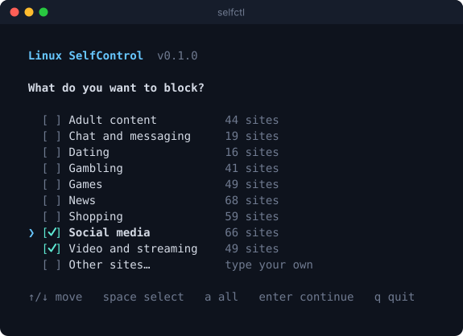
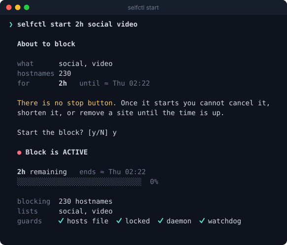
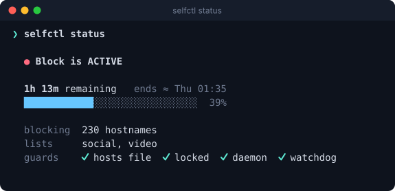
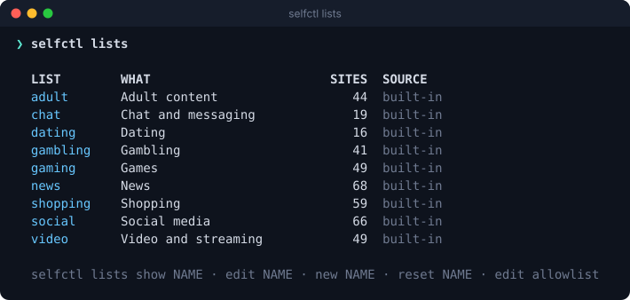
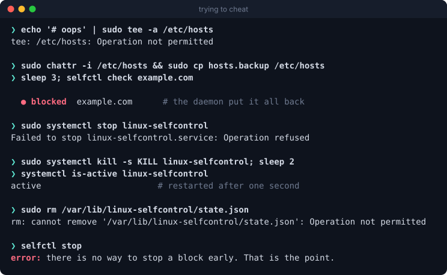

<p align="center">
  
</p>

<h1 align="center">Linux SelfControl</h1>

<p align="center">
  Block distracting websites for a set amount of time.<br>
  Once the timer starts, <b>there is no stop button</b>, not even for root with one command.
</p>

<p align="center">
  <a href="https://github.com/iYassr/linux-selfcontrol/actions/workflows/ci.yml"></a>
  
  
  
</p>

<p align="center">
  
</p>

Linux SelfControl is a small command line tool, `selfctl`, inspired by
[SelfControl for macOS](https://selfcontrolapp.com). You pick what to block
and for how long. Until the time is up, deleting the program, killing its
process, editing the hosts file, rebooting, or changing the system clock will
not bring the sites back.

- **System-wide.** Every browser and app on the machine is covered, because the
  block lives in the system resolver (`/etc/hosts`), not in a browser extension.
- **Hard to undo.** The hosts file is locked, a root daemon reverts any change
  within two seconds, and a watchdog restarts the daemon if it is killed.
- **Works offline.** No account, no server, no telemetry, no network access at all.
- **Clock-proof.** The countdown runs on the kernel's monotonic clock. Setting
  the date forward does nothing.
- **Ready-made lists.** Social media, video, news, shopping, games, chat, adult,
  gambling, dating. Edit them, or write your own.
- **Nothing to trust blindly.** One readable Python file, standard library only.
  When no block is running, nothing is running: no daemon, no service, no changes.

Tested on Omarchy (Arch), Debian, Ubuntu, Fedora, openSUSE and Alpine.

## Install

```sh
curl -fsSL https://raw.githubusercontent.com/iYassr/linux-selfcontrol/main/install.sh | sudo sh
```

Or, if you would rather read the code first (you should, it runs as root):

```sh
git clone https://github.com/iYassr/linux-selfcontrol
cd linux-selfcontrol
sudo ./install.sh
```

Arch and Omarchy users can also build a package with the
[PKGBUILD](packaging/PKGBUILD): `cd packaging && makepkg -si`.

The only requirement is Python 3.7 or newer, which nearly every distribution
already ships. Run `selfctl doctor` afterwards to check that your system is
fully supported.

## Use

Run `selfctl` and follow the menu, or do it in one line:

```sh
selfctl start 2h social video        # two hours without social media and video
selfctl start 45m reddit.com         # a single site
selfctl start 1h30m social news -y   # skip the "are you sure" question
```

<p align="center">
  
</p>

While a block is running you can only make it stricter:

```sh
selfctl status          # time left, and whether every guard is in place
selfctl add news        # block more sites
selfctl extend 30m      # make it longer
selfctl check x.com     # is this site blocked right now?
```

<p align="center">
  
</p>

Durations look like `25m`, `2h`, `1h30m` or `1d`. The longest block is 30 days.

## Lists

```sh
selfctl lists                  # everything available
selfctl lists show social      # the sites in one list
selfctl lists edit social      # change a built-in list (opens your editor)
selfctl lists new work         # create your own list
selfctl lists reset social     # go back to the built-in version
selfctl lists edit allowlist   # sites that must never be blocked
```

<p align="center">
  
</p>

A list is a plain text file with one site per line, kept in
`~/.config/selfctl/lists/`. You can paste full URLs; `selfctl` keeps the
hostname. `www.` is added for you. Other subdomains need their own line,
because a hosts file has no wildcards. The built-in lists already include the
subdomains that matter (`m.facebook.com`, `old.reddit.com` and so on).

The allowlist wins over every list. If you need LinkedIn for work, put
`linkedin.com` on it and the `social` list will skip it.

Found a site that belongs in a built-in list? Pull requests are welcome, see
[CONTRIBUTING.md](CONTRIBUTING.md).

## How it works

When you start a block, `selfctl`:

1. Adds every blocked hostname to `/etc/hosts`, pointing at `0.0.0.0` and `::`.
   Lookups are answered locally and instantly, which is why it works offline.
2. Sets the immutable flag on `/etc/hosts` (`chattr +i`), so even root gets
   "Operation not permitted" when trying to edit it.
3. Starts a small root daemon that checks every two seconds that the entries,
   the lock, and its own state are intact, and repairs whatever was changed.
4. Starts a systemd timer that restarts the daemon if it dies. The daemon in
   turn reinstalls and re-enables the timer and the service files.
5. Turns off DNS-over-HTTPS in Chromium, Chrome, Brave, Edge and Firefox for
   the duration, and blocks the hostnames browsers use to set it up. Otherwise
   a browser could look up sites behind the system's back.

When the time is up, the daemon removes all of it: the hosts entries, the lock,
the browser policy files, the service, the timer. Your hosts file is restored
byte for byte, and nothing stays running.

### The countdown

The remaining time is counted on the kernel's boot clock, which includes
suspend and cannot be set by hand. So:

- Changing the date or timezone does not shorten a block.
- Rebooting does not end a block. It resumes as soon as the system is up.
- Time the computer spends switched off counts only when the clock is
  synchronised by a time server (NTP). The kernel drops that "synchronised"
  mark the moment someone sets the clock by hand. On a machine that is offline
  and never syncs, a block counts powered-on time only, so it can last longer
  than planned but never shorter.

### What happens if you try to cheat

This is a transcript from the test run on a live Omarchy system:

<p align="center">
  
</p>

## How hard is it to undo, honestly?

Hard enough that it takes real effort and a clear head, which is the goal.
It is not a security boundary. You own the machine, and someone with root, time
and determination can always win, for example by booting a live USB and
cleaning up by hand. The tool is built so that every quick way out fails:

| You try | What happens |
| --- | --- |
| `selfctl stop` | That command does not exist |
| Edit `/etc/hosts` | Operation not permitted |
| Unlock and edit `/etc/hosts` | Reverted and locked again within 2 seconds |
| Stop or kill the daemon | Refused, or restarted after 1 second |
| Disable, mask or delete the service | Reinstalled and re-enabled within 30 seconds |
| Delete the state file | Operation not permitted; rewritten from memory if you unlock it |
| Change the system clock | Ignored |
| Reboot | The block resumes at boot |
| Uninstall | Refused while a block is running |

Things a hosts-file block cannot stop, and that you should know about:

- **Other routes to the internet.** A VPN, a proxy, or the Tor Browser resolves
  names somewhere else. So does your phone.
- **Open connections.** A tab that is already streaming may keep going for a
  minute or two. Restart the browser after starting a block.
- **Unknown subdomains and new domains.** Only the names in your lists are
  blocked. If a site moves, add the new name with `selfctl add`.
- **Other tools that write to `/etc/hosts`.** They will get a permission error
  while a block is running. They work again afterwards.

If you block something you turn out to need, the fix is to wait. Start with
short blocks until you trust your lists.

## Omarchy

`selfctl` was developed and tested on Omarchy. The installer adds a launcher
entry, so "Linux SelfControl" shows up in the app menu. To put it on a key,
add this to `~/.config/hypr/bindings.conf`:

```
bindd = SUPER SHIFT, B, SelfControl, exec, omarchy-launch-tui selfctl
```

For a status bar that can run a command (Waybar's `custom` module, for
example), `selfctl status --short` prints `🔒 1h 13m` during a block and
nothing otherwise. `selfctl status --json` gives the same data to scripts.

## Uninstall

```sh
sudo ./install.sh --uninstall
```

This is refused while a block is running. Your own lists in
`~/.config/selfctl` are kept.

## Files

| Path | What |
| --- | --- |
| `/usr/local/bin/selfctl` | the program |
| `/usr/local/share/linux-selfcontrol/lists/` | built-in lists |
| `~/.config/selfctl/` | your lists, allowlist and last selection |
| `/var/lib/linux-selfcontrol/` | state of the running block (only during a block) |
| `/etc/systemd/system/linux-selfcontrol*` | service and watchdog (only during a block) |

On systems without systemd the block still works and the daemon is started
directly, but it will not be restarted after a reboot. Add `selfctl _daemon`
to your init system if you need that.

## Development

```sh
make test                   # unit tests, no root needed, runs in a temp directory
sh tests/system-test.sh     # real 40 second block on this machine (needs sudo)
make screenshots            # regenerate the README images from real output
```

CI runs the unit tests on several Python versions, a real block on a systemd
machine, and an end-to-end test inside Debian, Ubuntu, Fedora, Arch, Alpine and
openSUSE containers.

Security reports: see [SECURITY.md](SECURITY.md).

## Credits

Inspired by [SelfControl](https://selfcontrolapp.com) for macOS by Charlie
Stigler and Steve Lambert. This project shares the idea, not the code.

MIT licensed. See [LICENSE](LICENSE).
